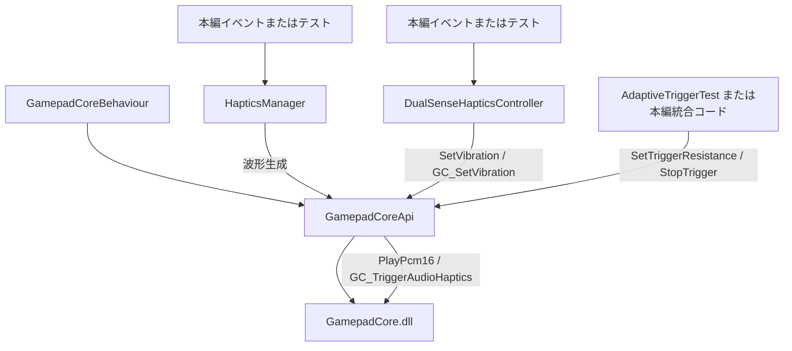

# DIVE RACE DualSense Haptics 統合資料

> この資料は現在の実装に合わせた統合手順です。設定値は
> `Assets/2.Ooka/DualSense/Haptics/` のScriptableObjectで管理します。

## 1. 概要

本資料は、Repository内にあるDualSense向け実装をDIVE RACE本編へ統合する際の参照資料です。対象は次の機能です。

- 通常の左右モーター振動
- 48 kHz・16 bit・ステレオPCMによる振動
- 落下、横移動、障害物接近・衝突・通過のハプティクス
- Adaptive Triggerの抵抗設定・解除

現時点で確認できる状態は次のとおりです。

| 区分 | 状態 |
|---|---|
| GamepadCore DLL/APIラッパー | Repositoryに存在 |
| 初期化・更新・終了コンポーネント | `GamepadCoreBehaviour`として実装 |
| HapticsManager | 実装済み。テスト用シーンに配置 |
| Adaptive Trigger API | `GamepadCoreApi`に実装 |
| 本編プレイヤー・障害物との接続 | 確認できず、未統合 |
| 本編シーンへの配置 | `Scene_DualSense`には存在するが、本編シーンでは確認できず |
| 実機動作 | Repository内に実行記録はなく、未確認 |

「実装済み」はコードが存在することを示し、「実機確認済み」や「本編統合済み」を意味しません。

## 2. システム構成

### 2.1 役割

- **GamepadCore.dll**  
  `Assets/2.Ooka/DualSense/GamepadCore/GamepadCore.dll`にあるWindows x64向けネイティブDLLです。入力、通常振動、PCM、Adaptive Trigger等のネイティブAPIを提供します。
- **GamepadCoreApi**  
  `GamepadCore.dll`を`DllImport`で呼び出すC#ラッパーです。初期化、更新、接続状態取得、通常振動、PCM、Adaptive Triggerを公開します。
- **GamepadCoreBehaviour**  
  Unityの`Awake`、`Update`、`OnApplicationQuit`、`OnDestroy`から`GamepadCoreApi`を呼び出します。`[DefaultExecutionOrder(-1000)]`が指定されています。
- **HapticsManager**  
  意味的な振動要求を受け付け、ScriptableObject設定から実行時状態を更新し、
  PCMサンプルを生成・合成して`GamepadCoreApi.PlayPcm16`へ送信します。
- **DualSenseHapticsController**  
  `GamepadCoreApi.SetVibration`による左右モーター振動と、コルーチンによるパルス・交互振動を提供します。`HapticsManager`とは別経路です。
- **HapticType**  
  `Falling`、`HorizontalMovement`、`ObstacleApproach`、`ObstacleCollision`、`ObstaclePassing`を定義します。
- **HapticWaveform**  
  `Noise`、`Sine`、`Triangle`、`Square`を定義します。
- **HapticSettings.cs**
  振動形態ごとのScriptableObject設定クラスを定義します。

### 2.2 制御経路



図中の「本編イベント」から各コンポーネントへの接続は、現Repositoryでは未確認です。図は既存コードで確認できるAPI依存関係と、統合時に想定される呼び出し境界を分けて示しています。

### 2.3 初期化・更新・終了

`GamepadCoreBehaviour`は次の処理を行います。

1. `Awake`で`GamepadCoreApi.Initialize()`を呼ぶ。
2. 初期化失敗時は`GamepadCoreApi.LastError`をログ出力する。
3. `Update`で`GamepadCoreApi.Update(Time.unscaledDeltaTime)`を呼ぶ。
4. `OnApplicationQuit`および再生中でない場合の`OnDestroy`で`GamepadCoreApi.Shutdown()`を呼ぶ。

`HapticsManager`と`DualSenseHapticsController`は初期化処理を持たず、出力前に`GamepadCoreApi.IsInitialized`と接続台数を確認します。

## 3. ファイル構成と責務

### 3.1 本編統合候補

| 相対パス | 役割 | 本編利用 | 注意事項 |
|---|---|---:|---|
| `Assets/2.Ooka/DualSense/GamepadCore/GamepadCore.dll` | ネイティブ実装 | 必須 | Windows x64 DLL。対応プラットフォーム要確認 |
| `Assets/2.Ooka/DualSense/GamepadCore/GamepadCoreApi.cs` | DLL/APIラッパー | 必須 | デバイスインデックスは実装上主に`0` |
| `Assets/2.Ooka/DualSense/GamepadCore/GamepadCoreBehaviour.cs` | 初期化・更新・終了 | 必須 | `HapticsManager`より先に有効化される配置を検討 |
| `Assets/2.Ooka/DualSense/Runtime/HapticsManager.cs` | 要求受付、状態管理、PCM合成・出力 | 利用候補 | 本編イベントから意味的APIを呼ぶ |
| `Assets/2.Ooka/DualSense/Runtime/HapticSettings.cs` | ScriptableObject設定クラス | 必須 | 設定アセットの型を提供 |
| `Assets/2.Ooka/DualSense/Haptics/` | 5種類の設定アセット | 必須 | Inspectorから調整 |
| `Assets/2.Ooka/DualSense/Runtime/DualSenseHapticsController.cs` | 通常モーター制御 | 利用候補 | PCM経路との併用方針は要確認 |
| `Assets/2.Ooka/DualSense/Runtime/HapticType.cs` | 振動種別enum | 利用 | `RequestHaptics`の対応範囲に注意 |
| `Assets/2.Ooka/DualSense/Runtime/HapticWaveform.cs` | 波形enum | 利用 | 主に落下振動の波形指定に使用 |

### 3.2 テスト専用ファイル

| 相対パス | 検証対象 |
|---|---|
| `Assets/2.Ooka/DualSense/Test/AdaptiveTriggerTest.cs` | L2/R2抵抗設定・解除、入力ログ |
| `Assets/2.Ooka/DualSense/Test/DualSenseVibrationTest.cs` | 左右モーターの直接振動 |
| `Assets/2.Ooka/DualSense/Test/DualSenseHapticTest.cs` | Unity Input System経由の振動 |
| `Assets/2.Ooka/DualSense/Test/DualSenseHapticsPatternTest.cs` | 交互・強度変化・同時振動 |
| `Assets/2.Ooka/DualSense/Test/DualSensePcmTest.cs` | 片側PCM |
| `Assets/2.Ooka/DualSense/Test/DualSensePcmChannelTest.cs` | 左右チャンネル別PCM |
| `Assets/2.Ooka/DualSense/Test/DualSenseWaveformTest.cs` | 波形別PCM |
| `Assets/2.Ooka/DualSense/Test/DualSenseFallHapticsTest.cs` | 落下速度シミュレーションのPCM |
| `Assets/2.Ooka/DualSense/Test/HapticsManagerTest.cs` | 落下、停止、ポーズ |
| `Assets/2.Ooka/DualSense/Test/HapticsRequestCallerTest.cs` | 外部呼び出し例 |
| `Assets/2.Ooka/DualSense/Test/HapticsFallSpeedSimulationTest.cs` | 落下速度からの要求 |
| `Assets/2.Ooka/DualSense/Test/HapticsHorizontalTest.cs` | 左右移動 |
| `Assets/2.Ooka/DualSense/Test/HapticsObstacleApproachTest.cs` | 障害物接近 |
| `Assets/2.Ooka/DualSense/Test/HapticsObstacleCollisionTest.cs` | 障害物衝突 |
| `Assets/2.Ooka/DualSense/Test/HapticsObstaclePassingTest.cs` | 障害物通過方向 |
| `Assets/2.Ooka/DualSense/Test/HapticsWaveformFrequencyTest.cs` | 周波数、波形、ポーズ |

テストシーンは`Assets/2.Ooka/Scenes/Scene_DualSense.unity`です。ここには`GamepadCoreBehaviour`、`HapticsManager`、`DualSenseHapticsController`、`AdaptiveTriggerTest`が配置されています。各テストコンポーネントの有効・無効状態はシーン設定に依存します。

## 4. 初期化とライフサイクル

### 4.1 シーンへの配置

統合時には、少なくとも次のコンポーネントを同じライフサイクル内に配置する必要があります。

1. `GamepadCoreBehaviour`
2. `HapticsManager`
3. 必要に応じて`DualSenseHapticsController`

`GamepadCoreBehaviour`は`DefaultExecutionOrder(-1000)`により早期実行されますが、実際のシーン階層やシーン遷移後の存在期間は本編側で決定する必要があります。

`DontDestroyOnLoad`や常駐オブジェクトの採用は、既存実装からは確認できません。採用する場合は、複数の`GamepadCoreBehaviour`が同時に存在しないことを確認してください。

### 4.2 未接続時

`HapticsManager.PlayCombinedHaptics`、`DualSenseHapticsController.CanControlDevice`、各種テストは、初期化状態と`ConnectedCount`を確認してから出力します。未接続時は当該出力を行いません。

未接続から再接続した場合の状態復元やデバイスインデックスの再選択は、実装上の統合仕様として定義されていません。

### 4.3 無効化・終了時

`DualSenseHapticsController`は`OnDisable`と`OnApplicationQuit`で通常モーター振動とパターンを停止します。

一方、`HapticsManager`は`OnDisable`と`OnApplicationQuit`で
`StopAudioHaptics`を呼び出します。ポーズ時は新規PCM生成を抑止しますが、
既に送信済みのPCMを停止する仕様ではありません。

## 5. HapticsManagerのAPI仕様

### 5.1 `RequestHaptics`

```csharp
public void RequestHaptics(
    HapticType type,
    float intensity,
    float frequencyHz = 50f,
    HapticWaveform waveform = HapticWaveform.Noise,
    float direction = 0f)
```

`intensity`は0～1に、`frequencyHz`は1～1000 Hzにクランプされます。

| `type` | 実装上の動作 | 停止方法 |
|---|---|---|
| `HapticType.Falling` | 強度を落下速度比として保存し、周波数・波形を更新 | `StopFallingHaptics()`または強度0の要求 |
| `HapticType.HorizontalMovement` | 強度と方向（-1～1）を保存 | `StopHorizontalHaptics()`または強度0の要求 |
| `HapticType.ObstacleApproach` | `default`分岐で警告ログ。接近処理はしない | 専用メソッドを使用 |
| `HapticType.ObstacleCollision` | `default`分岐で警告ログ。衝突処理はしない | 専用メソッドを使用 |
| `HapticType.ObstaclePassing` | `default`分岐で警告ログ。通過処理はしない | 専用メソッドを使用 |

### 5.2 落下

落下速度を0～1へ正規化して渡します。

```csharp
hapticsManager.RequestHaptics(
    HapticType.Falling,
    fallSpeedRatio,
    frequencyHz,
    HapticWaveform.Noise);
```

停止時は次を呼びます。

```csharp
hapticsManager.StopFallingHaptics();
```

`HapticsManager`は`_fallSpeedRatio`を振幅へ補間します。設定値は
`Falling.asset`から読み込み、落下振動を更新し続ける場合は
`SetFalling(fallSpeedRatio)`を繰り返し呼びます。速度の取得元、最大速度、
着地イベントは本編側で決定してください。

### 5.3 横移動

方向は負値を左、正値を右として扱います。

```csharp
hapticsManager.RequestHaptics(
    HapticType.HorizontalMovement,
    horizontalIntensity,
    direction: -1f); // 左

hapticsManager.RequestHaptics(
    HapticType.HorizontalMovement,
    horizontalIntensity,
    direction: 1f);  // 右
```

移動終了時は次を呼びます。

```csharp
hapticsManager.StopHorizontalHaptics();
```

本編統合では次の意味的APIを使用します。

```csharp
hapticsManager.SetFalling(fallSpeedRatio);
hapticsManager.StopFalling();
hapticsManager.SetHorizontalMovement(intensity, direction);
hapticsManager.StopHorizontalMovement();
hapticsManager.StartObstacleApproach();
hapticsManager.StopObstacleApproach();
hapticsManager.PlayObstacleCollision();
hapticsManager.PlayObstaclePassing(direction);
```

左右のPCMチャンネルは、指定方向側を強く、反対側を`_horizontalSecondaryWeight`で弱くします。

### 5.4 障害物への接近

```csharp
hapticsManager.StartObstacleApproachHaptics();
// 接近判定を外れたとき
hapticsManager.StopObstacleApproachHaptics();
```

接近中は`_approachInterval`ごとに短いTriangle波を生成します。接近判定の開始・終了イベントは本編の障害物制御側から接続してください。

### 5.5 障害物との衝突

```csharp
// 衝突イベントが発生した瞬間
hapticsManager.TriggerObstacleCollisionHaptics();
```

次回のPCM生成時に、`_collisionPulseDuration`の範囲へ衝突波形を加算し、その後保留状態を解除します。呼び出し側で停止メソッドを呼ぶ仕様ではありません。

### 5.6 移動障害物の通過

```csharp
hapticsManager.StartObstaclePassingHaptics(1f);  // 右からの通過
hapticsManager.StartObstaclePassingHaptics(-1f); // 左からの通過
```

`direction < 0`は左、それ以外は右へ正規化されます。`_passingDuration`経過後は`Update`で自動停止します。イベントをキャンセルする場合は次を呼びます。

```csharp
hapticsManager.StopObstaclePassingHaptics();
```

### 5.7 ポーズ

```csharp
hapticsManager.SetPaused(true);  // PCM生成を停止
hapticsManager.SetPaused(false); // 再開
```

`SetPaused`は内部フラグと再生タイマーを更新し、ポーズ中の新規PCM生成を抑止します。既に送信済みのPCMをネイティブ側で停止する処理は実装されていないため、即時停止を完了条件にする場合は要確認です。

## 6. PCMと振動の仕様

### 6.1 PCM

`GamepadCoreApi.PlayPcm16`のコメントおよび`HapticsManager`の実装から、PCMは次の前提です。

- サンプルレート：48,000 Hz
- サンプル：符号付き16 bit (`short`)
- チャンネル：ステレオインターリーブ
- 配列：`[left, right, left, right, ...]`
- 送信API：`GamepadCoreApi.PlayPcm16(int index, short[] interleavedStereo)`

`HapticsManager`は`_clipDuration`（シーン初期値0.5秒）ごとにサンプル配列を生成し、`PlayPcm16`を呼びます。戻り値が`1`以外の場合は警告ログを出しますが、リトライや状態復旧は行いません。

### 6.2 波形

`HapticWaveform`と`GetWave`の対応は次のとおりです。

| 波形 | 実装 |
|---|---|
| `Sine` | `Mathf.Sin` |
| `Triangle` | `2 / π * asin(sin(phase))` |
| `Square` | `sin(phase) >= 0`で±1 |
| `Noise` | `Random.Range(-1f, 1f)` |

落下、横移動、接近、衝突、通過で使用する波形は`HapticsManager.PlayCombinedHaptics`の実装に従います。横移動はTriangle、接近はTriangle、衝突と通過はSquareです。

### 6.3 左右チャンネルと合成

`PlayCombinedHaptics`は、同じPCM配列の各サンプルについて、アクティブな振動要素を左右チャンネルへ加算します。

- 落下：左右同じ強度
- 横移動：方向側を強く、反対側を二次ウェイトで加算
- 接近：左右同じ強度
- 衝突：左右同じ強度
- 通過：通過方向側を強く、反対側を二次ウェイトで加算

合成後の値は-1～1へクランプして16 bit PCMへ変換します。複数イベントが同時に有効な場合は、これらの波形が加算されます。

### 6.4 通常振動との併用

`DualSenseHapticsController`とテストコードは`GamepadCoreApi.SetVibration`を使用し、`HapticsManager`は`PlayPcm16`を使用します。両経路の優先順位、同時実行時の出力、停止順はRepository上で定義されていません。本編では、PCMを主経路にするか通常振動を併用するかを先に決定してください。

`GamepadCoreApi`には`StopAudioHaptics`、`IsAudioHapticsProcessing`、`QueuedHapticCount`がありますが、`HapticsManager`からは使用されていません。

## 7. Adaptive Trigger

### 7.1 利用可能なAPI

`GamepadCoreApi`には次のAPIがあります。

```csharp
GamepadCoreApi.SetTriggerResistance(
    int index,
    byte startZone,
    byte strength,
    GamepadHand hand);

GamepadCoreApi.StopTrigger(
    int index,
    GamepadHand hand);
```

その他に、`SetTriggerCustom`、`SetTriggerGameCube`、`SetTriggerBow`、`SetTriggerGalloping`、`SetTriggerWeapon`、`SetTriggerMachineGun`、`SetTriggerMachine`があります。

### 7.2 抵抗の設定・解除

```csharp
GamepadCoreApi.SetTriggerResistance(
    deviceIndex,
    (byte)startZone,
    (byte)strength,
    GamepadHand.Both);

GamepadCoreApi.StopTrigger(
    deviceIndex,
    GamepadHand.Both);
```

`GamepadHand.Both`は左右へ個別にAPIを送信します。

`AdaptiveTriggerTest`では、Inspector値を次の範囲で受け付けています。

- `startZone`：0～9
- `strength`：0～255

コード上のコメントでは`startZone`を抵抗開始位置、`strength`を抵抗強度として扱っていますが、ネイティブ側の詳細な物理的意味や機種差はRepositoryだけでは確定できません。

### 7.3 入力確認と本編接続

`AdaptiveTriggerTest.LogTriggerInput`はUnity Input Systemの`Gamepad.current`から次を読み取ります。

```csharp
float l2 = gamepad.leftTrigger.ReadValue();
float r2 = gamepad.rightTrigger.ReadValue();
```

テストではJキーで抵抗設定、Kキーで解除、一定間隔でL2/R2をログ出力します。これはテスト操作であり、本編のプレイヤー操作や姿勢・加速状態との接続は実装されていません。

本編統合時には、プレイヤー制御側でどの状態をL2/R2の抵抗へ反映するか、左右を個別に制御するか、状態終了時に必ず`StopTrigger`を呼ぶかを決定してください。

## 8. 本編への統合手順

### 8.1 必要資産の確認

1. `GamepadCore.dll`、`GamepadCoreApi.cs`、`GamepadCoreBehaviour.cs`が対象ビルドへ含まれることを確認する。
2. `GamepadCore.dll`がWindows x64向けであることを踏まえ、対象プラットフォームを決定する。
3. `HapticsManager`、必要なら`DualSenseHapticsController`を本編で使用する方針を決める。

### 8.2 初期化コンポーネントの配置

1. 本編の適切なシーンまたは常駐オブジェクトへ`GamepadCoreBehaviour`を配置する。
2. `Awake`がHaptics呼び出しより先に実行されることを確認する。
3. シーン遷移時に再生成するか常駐させるかを統合時に決定する。
4. 複数の初期化コンポーネントが存在しないことを確認する。

### 8.3 HapticsManagerの配置

1. `HapticsManager`を本編で参照可能なGameObjectへ配置する。
2. SerializeFieldの初期値を本編の振動設計と照合する。
3. 本編側の呼び出し元を統合時に決定する。現Repositoryには本編側の具体的なクラス名はありません。

### 8.4 プレイヤー制御との接続

プレイヤー制御側から次の情報を渡します。

- 落下中の速度または速度比
- 横移動の強度
- 横移動方向（左：負、右：正）
- 落下終了・横移動終了イベント

呼び出し先は次の既存APIです。

```csharp
hapticsManager.RequestHaptics(HapticType.Falling, fallSpeedRatio);
hapticsManager.StopFallingHaptics();
hapticsManager.RequestHaptics(
    HapticType.HorizontalMovement,
    intensity,
    direction: horizontalDirection);
hapticsManager.StopHorizontalHaptics();
```

速度や入力値をどの範囲へ正規化するかは本編のプレイヤー仕様に合わせて決定してください。

### 8.5 障害物制御との接続

障害物制御側から次のイベントを渡します。

```csharp
hapticsManager.StartObstacleApproachHaptics();
hapticsManager.StopObstacleApproachHaptics();
hapticsManager.TriggerObstacleCollisionHaptics();
hapticsManager.StartObstaclePassingHaptics(passingDirection);
hapticsManager.StopObstaclePassingHaptics();
```

接近判定の距離、衝突イベントの発火元、通過方向の算出方法は本編側で決定する必要があります。

### 8.6 Adaptive Triggerとの接続

プレイヤー状態から抵抗設定を開始・変更するタイミングを決定し、`SetTriggerResistance`または必要なTrigger APIを呼びます。状態終了、ポーズ、シーン遷移、コントローラー切断時の解除処理として`StopTrigger`を呼ぶ方針を検討してください。

### 8.7 ポーズ・シーン遷移・実機確認

1. ポーズ開始時に`SetPaused(true)`を呼ぶ。
2. ポーズ解除時に`SetPaused(false)`を呼ぶ。
3. 送信済みPCMを即時停止する必要がある場合、`StopAudioHaptics`の扱いを決める。
4. シーン遷移時に通常振動、PCM、Triggerをそれぞれ停止する方針を決める。
5. USB接続のDualSense実機で本編シーンを確認する。

## 9. テスト計画と完了条件

### 9.1 既存テストの用途

| スクリプト | 確認対象 | 成功の根拠 |
|---|---|---|
| `AdaptiveTriggerTest` | 抵抗設定・解除、L2/R2入力ログ | コードとログ出力処理は存在。実機結果は未確認 |
| `DualSenseVibrationTest` | 左右・同時の通常振動 | コードと操作ログは存在。実機結果は未確認 |
| `DualSenseHapticTest` | Input Systemの振動 | コードと接続ログは存在。実機結果は未確認 |
| `DualSenseHapticsPatternTest` | 通常振動パターン | コードは存在。実機結果は未確認 |
| `DualSensePcmTest` | PCM生成・送信 | `PlayPcm16`結果をログ出力。実行記録は未確認 |
| `DualSensePcmChannelTest` | 左右別周波数PCM | 接続・デバイス種別確認と結果ログあり。実行記録は未確認 |
| `DualSenseWaveformTest` | 4種類の波形 | コードと結果ログは存在。実機結果は未確認 |
| `DualSenseFallHapticsTest` | 落下速度によるPCM強度 | コードと結果ログは存在。実機結果は未確認 |
| `HapticsManagerTest` | 落下・停止・ポーズ | 操作ログは存在。実機結果は未確認 |
| `HapticsRequestCallerTest` | 外部呼び出し例 | 呼び出しコードは存在。実機結果は未確認 |
| `HapticsFallSpeedSimulationTest` | 速度比の継続要求 | シミュレーションコードは存在。実機結果は未確認 |
| `HapticsHorizontalTest` | 左右方向と停止 | 呼び出しコードは存在。実機結果は未確認 |
| `HapticsObstacleApproachTest` | 接近開始・停止 | 呼び出しコードは存在。実機結果は未確認 |
| `HapticsObstacleCollisionTest` | 衝突要求 | 呼び出しコードは存在。実機結果は未確認 |
| `HapticsObstaclePassingTest` | 左右通過 | 呼び出しコードは存在。実機結果は未確認 |
| `HapticsWaveformFrequencyTest` | 周波数・波形・ポーズ | 呼び出しコードは存在。実機結果は未確認 |

### 9.2 本編統合後チェックリスト

- [ ] `GamepadCoreBehaviour.Awake`がHaptics利用より先に完了する
- [ ] コントローラー接続時に正しいデバイスが選択される
- [ ] 未接続時に例外や不要な出力が発生しない
- [ ] 落下速度の変化が振動強度へ反映される
- [ ] 落下終了時に振動が停止する
- [ ] 左移動と右移動で方向が正しく分かれる
- [ ] 横移動終了時に振動が停止する
- [ ] 障害物接近の開始・終了が正しく発火する
- [ ] 障害物衝突で一回分の振動が発生する
- [ ] 移動障害物の通過方向が左右へ正しく反映される
- [ ] 複数イベント同時発生時の合成結果を確認する
- [ ] ポーズ開始・再開時の出力を確認する
- [ ] シーン遷移時に振動・PCM・Triggerが残留しない
- [ ] Adaptive Triggerの抵抗設定と解除を確認する
- [ ] L2/R2入力と本編操作の対応を確認する
- [ ] コントローラー抜去・再接続を確認する
- [ ] USB/Bluetoothの対応方針と実機結果を記録する
- [ ] 実機で出力を確認し、ログと結果を保存する

完了判定では、少なくとも「コード存在」「テストコードあり」「実機確認済み」「本編統合済み」を別々に記録してください。

## 10. 未確定事項と既知の注意点

次の順番で確認することを推奨します。

1. **対応プラットフォーム**  
   `GamepadCore.dll`はWindows x64 DLLです。本編の対象プラットフォームと配布方法を確定します。
2. **初期化コンポーネントの常駐方法**  
   `GamepadCoreBehaviour`を各シーンへ置くか、常駐させるかを決めます。`DontDestroyOnLoad`は実装上未確認です。
3. **本編側の接続先**  
   プレイヤー制御、障害物制御、ポーズ処理の実クラスとイベントを特定します。
4. **PCMと通常振動の併用方針**  
   `PlayPcm16`と`SetVibration`を同時に使用するか、優先順位と停止処理を決めます。
5. **ポーズ時のPCM停止**  
   `SetPaused`は新規生成を止めますが、送信済みPCM停止は未実装です。`StopAudioHaptics`を使用するか確認します。
6. **無効化・シーン遷移時の停止**  
   `DualSenseHapticsController`は通常振動を停止しますが、`HapticsManager`はPCM停止を行いません。
7. **抜去・再接続**  
   接続台数変化、デバイスインデックス、状態復元を確認します。
8. **Adaptive Trigger設計**  
   L2/R2へどのプレイヤー状態を割り当てるか、`startZone`と`strength`の設計値を決めます。
9. **実機検証**  
   USB/Bluetooth、DualSense機種、入力・出力・シーン遷移を確認します。

既存コードには専用仕様書がなく、仕様の一部はSerializeField初期値、Tooltip、テストコードから読み取ったものです。ネイティブDLLの詳細仕様や実機挙動はコードだけでは確定できません。

## 11. 関連ファイル

- `Assets/2.Ooka/DualSense/GamepadCore/GamepadCore.dll`
- `Assets/2.Ooka/DualSense/GamepadCore/GamepadCoreApi.cs`
- `Assets/2.Ooka/DualSense/GamepadCore/GamepadCoreBehaviour.cs`
- `Assets/2.Ooka/DualSense/Runtime/HapticsManager.cs`
- `Assets/2.Ooka/DualSense/Runtime/DualSenseHapticsController.cs`
- `Assets/2.Ooka/DualSense/Runtime/HapticType.cs`
- `Assets/2.Ooka/DualSense/Runtime/HapticWaveform.cs`
- `Assets/2.Ooka/DualSense/Test/AdaptiveTriggerTest.cs`
- `Assets/2.Ooka/DualSense/Test/DualSenseVibrationTest.cs`
- `Assets/2.Ooka/DualSense/Test/DualSenseHapticTest.cs`
- `Assets/2.Ooka/DualSense/Test/DualSenseHapticsPatternTest.cs`
- `Assets/2.Ooka/DualSense/Test/DualSensePcmTest.cs`
- `Assets/2.Ooka/DualSense/Test/DualSensePcmChannelTest.cs`
- `Assets/2.Ooka/DualSense/Test/DualSenseWaveformTest.cs`
- `Assets/2.Ooka/DualSense/Test/DualSenseFallHapticsTest.cs`
- `Assets/2.Ooka/DualSense/Test/HapticsManagerTest.cs`
- `Assets/2.Ooka/DualSense/Test/HapticsRequestCallerTest.cs`
- `Assets/2.Ooka/DualSense/Test/HapticsFallSpeedSimulationTest.cs`
- `Assets/2.Ooka/DualSense/Test/HapticsHorizontalTest.cs`
- `Assets/2.Ooka/DualSense/Test/HapticsObstacleApproachTest.cs`
- `Assets/2.Ooka/DualSense/Test/HapticsObstacleCollisionTest.cs`
- `Assets/2.Ooka/DualSense/Test/HapticsObstaclePassingTest.cs`
- `Assets/2.Ooka/DualSense/Test/HapticsWaveformFrequencyTest.cs`
- `Assets/2.Ooka/Scenes/Scene_DualSense.unity`
- `ProjectSettings/EditorBuildSettings.asset`
- `ProjectSettings/ProjectVersion.txt`
